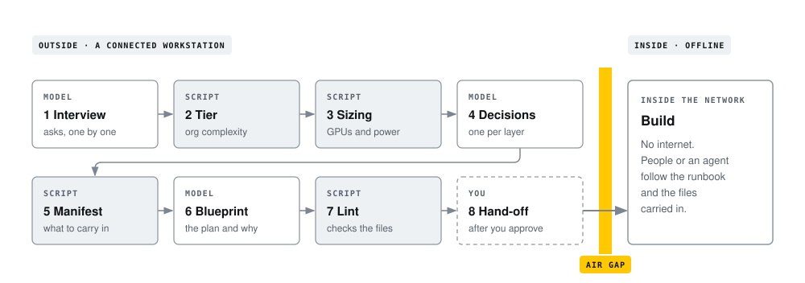

<p align="center">
  
</p>

<h1 align="center">airgap-anything</h1>

<p align="center">Design any system for air-gapped environments.</p>

<p align="center">
  <a href="https://github.com/mftnakrsu/airgap-anything/actions/workflows/ci.yml"></a>
  
  <a href="LICENSE"></a>
</p>

<p align="center">
  <a href="#install"><b>Install</b></a> ·
  <a href="#use">Use</a> ·
  <a href="CONTRIBUTING.md">Contributing</a> ·
  <a href="#türkçe">Türkçe</a>
</p>

`airgap-anything` is a home for agent skills that design systems for networks without internet access. Its first skill, `airgap-architect`, interviews you about your organization and writes a blueprint: one component per layer, GPU sizing, the reason for each choice, and the list of everything that has to be carried into the network.

Version 0.1 covers the core pipeline and the LLM platform layer. See [Scope](#scope).

<p align="center">
  
</p>

## Why

Architecture skills usually assume internet access and hosted services. Skills for air-gapped work usually explain one tool at a time. `airgap-architect` is the layer above: one interview, one blueprint for the whole stack, written for a network where nothing can be looked up or downloaded.

It decides; it does not operate. For the details of running each tool, catalog entries point to existing per-tool skills.

## Install

Install it once; after that you only ask (see [Use](#use)). The skill needs Python 3.11 or newer on the machine where the design is made. It has no other dependency and makes no network calls.

### Claude Code

```
/plugin marketplace add mftnakrsu/airgap-anything
/plugin install airgap-anything@airgap-anything-marketplace
```

### Other agents that support Agent Skills

```bash
npx skills add mftnakrsu/airgap-anything -g
```

`-g` installs it for your user, so every project has it; without `-g` it goes into the current project only. Add `-a` and an agent ID to choose the agent, for example `-a codex`, `-a cursor`, `-a opencode` or `-a gemini-cli`. The [skills CLI](https://github.com/vercel-labs/skills) supports Claude Code, Codex, Cursor, OpenCode and 75 more agents; its [agent list](https://github.com/vercel-labs/skills/blob/main/docs/agents.md) has the IDs. This route needs Node.js 22.20 or newer. `npx skills update` updates the skill later.

### Without internet

On a connected machine, in a clone of this repository:

```bash
git archive --format=tar.gz --prefix=airgap-architect/ -o airgap-architect.tar.gz HEAD:plugins/airgap-anything/skills/airgap-architect
sha256sum airgap-architect.tar.gz > airgap-architect.tar.gz.sha256
```

Carry both files in, then:

```bash
sha256sum -c airgap-architect.tar.gz.sha256
mkdir -p ~/.claude/skills && tar -xzf airgap-architect.tar.gz -C ~/.claude/skills/
```

`~/.claude/skills/` is where Claude Code keeps personal skills. Use your agent's own skills directory if it differs.

## Use

Ask your agent, in your own words, on a machine with internet access:

> Design an air-gapped LLM platform for my organization.

You do not need to name the skill. Claude Code picks it when a request is about designing, planning or sizing a system for an air-gapped, offline or on-premises network, and leaves other requests alone; [a test](evals/results/2026-11-22-triggering.md) checks this in English and Turkish. In Claude Code you can also start it directly: with `/airgap-anything:airgap-architect` after the plugin install, or with `/airgap-architect` when it is installed as a personal or project skill (the `npx skills` and offline routes).

The skill then works through these steps:

| # | Step | Who |
|---|---|---|
| 1 | Interview: people, departments, privacy, hardware, operations | the agent, one question at a time |
| 2 | Tier and per-layer floors | `tier.py` |
| 3 | GPU, server and power sizing | `size.py` |
| 4 | One decision per layer, from decision tables and the catalog | the agent |
| 5 | Transfer manifest | `manifest.py` |
| 6 | Blueprint, and the agent block in `AGENTS.md` | the agent |
| 7 | Consistency check | `lint.py` |
| 8 | Your approval, then hand-off to an implementation plan | you |

## What you get

```
your-project/
├── docs/airgap/blueprint.json          answers, tier, sizing, decisions
├── docs/airgap/transfer-manifest.md    images, models, packages and settings to carry in
├── docs/airgap/blueprint.md            the blueprint (under docs/superpowers/specs/ with superpowers)
└── AGENTS.md                           instructions for the agent that builds it inside the network
```

These files travel into the network together with the artifacts the manifest lists. The agent inside follows them without internet access.

## Tiers and sizing are separate

A tier (T1 single team, T2 department, T3 enterprise) measures how complex the organization is: how many people and departments, and whether audit, isolation or zero downtime is required. It selects patterns such as "gateway or not" and "Compose or Kubernetes".

GPU count is a different question. It comes from the size of the model, the kind of usage and the headcount, and `size.py` computes it. A small team that serves a very large model needs many GPUs at T1.

Sizing covers memory, not speed. Every blueprint carries a "benchmark before production" step.

The agent runs the scripts itself; you never type these commands. This recording shows what they compute on the `department` example: 180 people in four departments, one 671-billion-parameter model on eight 141 GB GPUs. [design/demo/build_demo.py](design/demo/build_demo.py) runs the four scripts and draws it.

<p align="center">
  
</p>

## Evidence labels

Every catalog entry, threshold and decision-table row carries one label.

| Label | Meaning |
|---|---|
| `field` | Verified in a real deployment by a named person |
| `docs` | Taken from official project or vendor documentation, or, where the documentation is silent, from the project's source code at the release tag; the URL is recorded |
| `estimate` | Reasoned or community-sourced; verify before relying on it |

A decision inherits the weakest label among its inputs. Every decision that rests on an estimate is listed in the blueprint's verification section.

## Scope

In version 0.1:

- Decision tables for the inference engine and the LLM gateway.
- Fixed per-tier defaults for UI, identity, observability, orchestration, state stores and artifact registry.
- Sizing from organization answers, a transfer manifest, and lint.

Not in version 0.1:

- Deployment files such as Docker Compose or Helm.
- A recommendation of which model to run.
- Decision tables for data, CI/CD and security layers.
- Compliance mappings.

## Works with superpowers

When [superpowers](https://github.com/obra/superpowers) is installed, the blueprint is written where its specs live and handed to `superpowers:writing-plans` after you approve it. Without superpowers the skill works on its own.

## Contributing

The catalog is the part that ages. [CONTRIBUTING.md](CONTRIBUTING.md) explains how to add or verify an entry. One rule above all: nothing is written from memory.

Logo files and their usage rules are in the [brand guide](assets/brand/BRAND.md).

## License

MIT. See [LICENSE](LICENSE).

## Türkçe

`airgap-anything`, internete kapalı (air-gapped) ağlarda çalışacak sistemleri tasarlayan agent skill'lerini bir araya getirir. İlk skill olan `airgap-architect`, kurumunuzla kısa bir görüşme yapar ve bir blueprint yazar: her katman için tek bir bileşen, GPU, sunucu ve güç hesabı, her seçimin gerekçesi ve ağın içine taşınması gereken her şeyin listesi.

Tasarım internete bağlı bir makinede yapılır. Ağın içine blueprint dosyaları ile manifestin listelediği imajlar, modeller ve paketler taşınır; içerideki agent bu dosyaları internet olmadan izler. Betikler yalnızca Python 3.11 veya üstünün standart kütüphanesini kullanır ve ağa bağlanmaz.

Sürüm 0.1, temel akışı ve LLM platformu katmanını kapsar.

**Kurulum.** Bir kez kurarsınız; sonrasında yalnızca sorarsınız. Claude Code'da:

```
/plugin marketplace add mftnakrsu/airgap-anything
/plugin install airgap-anything@airgap-anything-marketplace
```

Agent Skills standardını destekleyen diğer agent'larda (Codex, Cursor, OpenCode, Gemini CLI ve diğerleri; agent seçmek için `-a`, örneğin `-a codex`):

```bash
npx skills add mftnakrsu/airgap-anything -g
```

`-g` skill'i kullanıcınız için kurar, böylece her projede hazır olur.

İnternetsiz kurulum için yukarıdaki [Without internet](#without-internet) bölümüne bakın.

**Kullanım.** İnternete bağlı bir makinede agent'ınıza kendi cümlenizle sorun, örneğin:

> Kurumum için internete kapalı bir LLM platformu tasarla.

Skill'in adını söylemeniz gerekmez: Claude Code, internete kapalı, çevrimdışı ya da kurum içi bir ağ için sistem tasarlama, planlama veya boyutlandırma isteklerinde skill'i kendisi seçer, başka isteklerde seçmez. Bunu Türkçe ve İngilizce isteklerle ölçen bir test vardır. Claude Code'da skill'i doğrudan da başlatabilirsiniz: plugin olarak kurduysanız `/airgap-anything:airgap-architect`, kişisel ya da proje skill'i olarak kurduysanız (`npx skills` veya internetsiz kurulum) `/airgap-architect` yazın.
