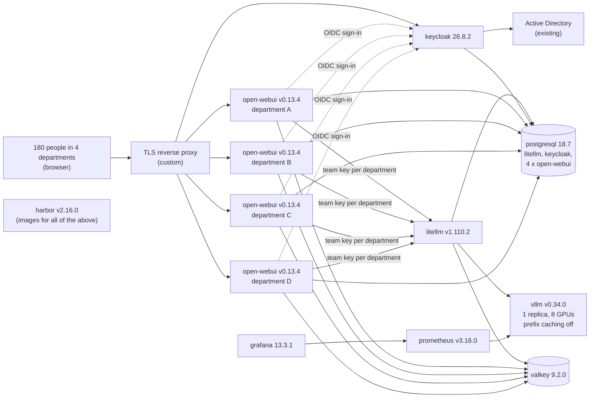

# Engineering division chat platform: air-gapped blueprint

Status: draft, waiting for approval. Date: 2026-11-25. Language: en. Oldest catalog entry used: 2026-11-21 (`open-webui`, `keycloak`, `prometheus`, `valkey`).

This blueprint is a design aid built from public documentation and labelled estimates, not professional advice. Verify every number, choice and version, and run the benchmark in section 9, before buying hardware or deploying anything.

## 1. Context and answers

An engineering division of 180 people in four departments gets a chat platform on one very large model (671 billion parameters, 8-bit) that runs on one server with eight GPUs inside an air-gapped network. Each department needs its own budget and must not see another department's prompts or data, and every request must be attributable to a person and kept for audit. A team of three without Kubernetes experience operates it; planned maintenance windows are acceptable, unplanned downtime should be rare. Active Directory exists; there is no API gateway, cluster or registry, and files enter on removable media. The user was not available for questions: everything the request did not state is `unknown` and takes the interview default.

| Question | Answer | From |
|---|---|---|
| `org.users_total` | 180 | the user |
| `org.departments` | 4 | the user |
| `org.isolation` | `per_department` | the user ("departments must not see each other's prompts or data"; no classification levels named) |
| `org.audit_required` | `true` | the user ("every request has to be attributable to a person and kept for audit") |
| `org.downtime_tolerance` | `planned_only` | the user ("planned maintenance windows are fine; unplanned downtime should be rare") |
| `org.ops_capacity` | `small_team` | the user (a team of three) |
| `org.kubernetes_experience` | `false` | the user |
| `inside.operator` | `people` | `unknown`, default |
| `workload.usage` | chat 1.0 | the user ("chat only") |
| `workload.models` | one model: `role` `chat`, `params_b` 671, `precision` 8-bit (`fp8` or `int8`, not stated which; both are 1 byte per parameter), `arch` unknown, `name` unknown | the user |
| `workload.context_tokens` | not asked: only one usage group | — |
| `hardware.gpus` | `[{model: "unnamed 141 GB GPU", count: 8, vram_gb: 141, tdp_w: 700, vendor: "nvidia"}]`, all eight in one server | the user |
| `hardware.ram_gb` | not asked: there are GPUs | — |
| `hardware.power_budget_kw` | `unknown` (optional, not used) | `unknown` |
| `hardware.cpu_arch` | `amd64` | `unknown`, default |
| `existing.identity` | `ad_ldap` (Active Directory) | the user |
| `existing.api_gateway` | `none` | the user |
| `existing.kubernetes` | `none` | the user |
| `existing.registry` | `none` | the user |
| `transfer.channel` | `removable_media` | the user |
| `transfer.cadence` | `unknown` (optional, not used) | `unknown` |

Open questions (the design proceeds on the stated assumptions until they are answered):

1. **GPU model.** The user gave 141 GB, 700 W and the vendor (NVIDIA) per GPU but no model name. The numbers match the H200 row of the GPU table, but a matching row is a guess, not an answer. The model decides which host GPU stack version is needed.
2. **The model's name, its 8-bit format (`fp8` or `int8`) and its architecture numbers.** With `num_hidden_layers`, `num_key_value_heads` (else `num_attention_heads`) and `head_dim` (else `hidden_size` ÷ `num_attention_heads`) from its `config.json`, the KV-cache capacity can be computed instead of only measured. The name is also needed to check that vLLM v0.34.0 supports the model and its 8-bit format on this GPU.
3. **CPU architecture** of the server (assumed `amd64`; a wrong value means the wrong package files).
4. **Whether a second host exists** for the registry, monitoring and the supporting services. The design puts everything on the GPU server; monitoring on the same host cannot report that host's failure.
5. **Disk space on the GPU server**: at least the weight files (about 671 GB by arithmetic), the images, the databases and the audit records.
6. **Budget amounts and period per department**, and the internal price unit that turns tokens into spend (section 4, `llm-gateway`).
7. **Audit retention**: how long records are kept, and whether the prompt and answer text must be kept or only who, when and how much.
8. **Certificates and names**: an internal certificate authority and DNS names for the web endpoints, and an LDAPS certificate for Active Directory.
9. **Backup target** outside the GPU server.
10. **Docker Engine and the operating system** on the server: already installed or carried in.
11. **Power** available for the system (the estimate is 10.1 kW).
12. **Who carries the media and how often** (`transfer.cadence`).
13. **Whether one server is acceptable for "unplanned downtime should be rare"**: see the what-ifs in section 5.

## 2. Tier, floors and overrides

Base tier **T2**: 180 users is T2 (51 to 300), 4 departments is T2 (2 to 5); the higher of the two is T2.

| Layer | Floor | Raised by |
|---|---|---|
| `llm-serving` | T2 | — |
| `llm-gateway` | T2 | `org.audit_required` = true and `org.isolation` = `per_department` (both raise to T2, already the base tier) |
| `ui` | T2 | — |
| `identity` | T2 | `org.isolation` = `per_department` (raises to T2, already the base tier) |
| `observability` | T2 | — |
| `orchestration` | T2 | — |
| `state` | T2 | — |
| `registry` | T2 | — |

Obligations:

- **A gateway is required** (from `org.audit_required` = true and from `org.isolation` = `per_department`). Met: `litellm`.
- No "Isolation design" subsection: `org.isolation` is `per_department`, not `multi_level`. How departments are kept apart is stated in the `llm-serving`, `llm-gateway`, `ui` and `identity` decisions and in section 7.
- No replica obligation: `org.downtime_tolerance` is `planned_only`, so the minimum is one replica.
- No Kubernetes risk: the `orchestration` floor is T2.

Overrides: none.

Custom parts (no catalog entry, each labelled `estimate`):

| Custom part | Decision | Why it is needed |
|---|---|---|
| Docker Engine | `orchestration`, `registry` | Compose and Harbor's installer need it; it is outside the catalog. |
| Host GPU stack (vendor driver and container runtime, for NVIDIA the driver and the NVIDIA Container Toolkit) | `orchestration` | The engine container needs the GPUs; the stack is the NVIDIA one (`hardware.gpus` names the vendor). |
| TLS reverse proxy | `ui` | The Open WebUI image listens on 8080 and its entry documents no TLS settings; Keycloak's production guide says all communication requires a secure channel and recommends a proxy in front; no catalog entry provides one. |

## 3. Architecture overview

Everything runs on the one GPU server as containers under Docker Compose, with images served from a Harbor registry on the same host. People sign in through a TLS reverse proxy to their own department's Open WebUI instance (four instances, one per department), which authenticates them with Keycloak federated to Active Directory. Each Open WebUI instance talks to the LiteLLM gateway with its department's team key; LiteLLM enforces the department budget and rate limits, writes a spend-log row per request to PostgreSQL and forwards the request to the single vLLM engine, which holds the model across all eight GPUs with prefix caching switched off so departments cannot reuse or probe each other's cached prompts. Prometheus scrapes the engine's metrics and Grafana shows and alerts on them.

Host: one server with 8 GPUs, Docker Engine and the host GPU stack (custom), `docker-compose` v5.8.0. The engine's network is reachable only from the gateway; the gateway only from the UIs and the operators.

## 4. Layer decisions

| Layer | Component | Version | Evidence |
|---|---|---|---|
| `llm-serving` | `vllm` | `v0.34.0` | estimate |
| `llm-gateway` | `litellm` | `v1.110.2` | estimate |
| `ui` | `open-webui` | `v0.13.4` | estimate |
| `identity` | `keycloak` | `26.8.2` | estimate |
| `observability` | `prometheus` | `v3.16.0` | estimate |
| `observability` | `grafana` | `13.3.1` | estimate |
| `orchestration` | `docker-compose` | `v5.8.0` | estimate |
| `state` | `postgresql` | `18.7` | estimate |
| `state` | `valkey` | `9.2.0` | estimate |
| `registry` | `harbor` | `v2.16.0` | estimate |

The Evidence column is the catalog entry's label. Each decision's own evidence, the weakest of its case and its components, is in its subsection: all eight are `estimate`. Custom parts are listed in section 2, not in this table, because they have no catalog version.

### `llm-serving`

- Components: `vllm` `v0.34.0`, one replica spanning all 8 GPUs (tensor parallel 8, or the parallel layout the benchmark shows to be best; the entry lists tensor, pipeline, data, expert and context parallelism).
- Existing: none
- Custom: none
- Benchmark only: none
- Rationale:
  - Case "Anything else" of the layer guide: there are GPUs, `concurrency.high` is 18 (above 4) and the operator is a small team, and the `code_assistant` plus `rag` share is 0 (below 0.5). The default `vllm` applies. vLLM batches requests continuously (README: "Continuous batching of incoming requests, chunked prefill, prefix caching"). The queue is set with `--max-num-seqs`, `--max-num-batched-tokens`, `--max-num-queued-reqs` and `--max-num-queued-tokens`. `--max-num-queued-reqs` is unlimited by default; set a bound so that overload returns HTTP 503 instead of an endless queue, with values taken from the benchmark.
  - **Department separation in the shared engine.** All four departments share this one engine, and the model needs all eight GPUs, so an instance per department would need 4 × 8 = 32 GPUs: not possible on this hardware. vLLM's prefix caching is on by default for generative models. Its security page says requests from different callers "share the same caches", that vLLM "does not provide isolation between tenants that share the same server process", and that a caller can infer from time to first token whether a guessed prefix is cached. Of the three separations the entry names, the design uses **prefix caching switched off** (`--no-enable-prefix-caching`). The third option, a gateway that sets a secret per-department `cache_salt`, is not documented for LiteLLM: the entry's sources document no per-team or per-key request parameters, so it would be a custom part. The security page also calls `cache_salt` a reduction of "specific cross-tenant risks", "not an isolation boundary". The cost of turning the cache off is not documented, so the benchmark measures it. Residual risk, accepted by this design and shown to the user: the departments still share one server process, which the page says vLLM does not isolate. Keeping departments apart in the UI alone would not isolate the cached prompts; that is why the engine flag is part of the decision.
  - The platform is text chat. If images are ever sent, the media caveat applies: the security page says clients must give media items UUIDs that are unique across all callers. Whether a salt protects the multimodal caches is not documented.
  - API key: `--api-key` protects only `/v1`, `/v2`, `/inference` and `/cohere`; `/invocations`, for example, is not authenticated. The engine therefore listens only on an internal container network that only LiteLLM can reach, with an API key as a second layer. gRPC (`--grpc-port`) stays off.
  - Memory: the 0.90 share of GPU memory in section 5 is a sizing assumption, not an engine default; vLLM v0.34.0 documents 1.0 on CUDA and ROCm and 0.92 elsewhere.
  - Air gap: the model is given as a local path, with `HF_HUB_OFFLINE=1`. Usage statistics go to `stats.vllm.ai` by default and are switched off (section 6). The API docs need `--enable-offline-docs`. For CUDA installs, vLLM downloads and compiles FlashInfer kernels at startup when the precompiled ones are missing; that is checked in section 9. Containers need `--ipc=host` or `--shm-size`.
  - The GPU vendor is NVIDIA: the manifest carries `vllm/vllm-openai:v0.34.0`, a multi-architecture manifest list of which the `linux/amd64` platform is copied.
- Alternatives considered:
  - `sglang`: the guide chooses it only with `field` evidence or the user's own measurements, which neither the entry nor the user has. The shared-prefix case that would add it as a benchmark does not apply (`code_assistant` + `rag` = 0). The user has no measurements of it either.
  - `ollama`: its tiers include T2, but its case needs `concurrency.high` of 4 or less and one part-time operator; here it is 18 and a team. It documents parallel requests per model and a queue, but no continuous batching.
- Evidence: `estimate` (case `estimate`, `vllm` `docs`)
- Override: none

### `llm-gateway`

- Components: `litellm` `v1.110.2` (one container; Valkey is configured from the start so that a second worker later does not count limits per worker)
- Existing: none
- Custom: none
- Benchmark only: none
- Rationale:
  - Case: audit is required, isolation is `per_department` and there are 4 departments, so the guide chooses `litellm`; a gateway is also an obligation of the tier.
  - Each department is a LiteLLM team with `max_budget`, `budget_duration` and `tpm_limit`/`rpm_limit`. Each department's Open WebUI instance uses a key of its own team, so one department's spend never draws on another's budget. Per-team limits also keep one department from filling the single engine's queue.
  - **Budgets need a price.** A model missing from LiteLLM's bundled cost map "price[s] at 0", so a self-hosted model would never reach a budget. The design defines an internal price per token for this model, as an internal unit set by the user (open question 6). It is carried in an internal copy of `model_prices_and_context_window.json`, served inside the network and named in `LITELLM_MODEL_COST_MAP_URL`, which is read at startup. The entry does not document whether `LITELLM_OFFLINE_MODE=true` would skip a configured URL, so the design sets the individual offline switches (section 6) instead of offline mode. The file is served by the TLS reverse proxy (custom, `ui` decision).
  - **License.** LiteLLM's documentation contradicts itself on whether teams, keys and budgets need the enterprise license. The team budget pages carry no license marker, while the Enterprise page lists "Multi-tenant Architecture. Organizations, teams, projects, and keys" among licensed features. This design relies on teams, keys and budgets, so section 9 says to confirm with the vendor which team and key features run without a license; neither answer is stated here as a fact. The design also does not rely on LiteLLM's licensed audit logs, which "without [a license] the proxy writes none", or on team-scoped admin roles. SSO for the Admin UI is free up to 5 users, which covers the three operators. If a license is bought, a key that passes the offline signature check must be obtained before installation. Otherwise LiteLLM calls `license.litellm.ai`, and the paid features switch off when that fails (from the source at tag v1.110.2, not documented). `enterprise/LICENSE.md` restricts production use of the `enterprise/` directory to licensed users; whether the image includes that directory was not checked.
  - **Attribution and audit.** PostgreSQL holds the virtual keys, teams, users, budgets and per-request spend logs; this is the gateway's half of the audit record (who, which team, when, how many tokens). Two points are not documented in the catalog and are checked in section 9. First, how Open WebUI passes the signed-in person, not only the department key, to the gateway. Second, which fields one spend-log row holds, and whether it holds the prompt text. Until both are confirmed, attribution to a person rests on the UI's own records (`ui` decision). If neither half holds what audit requires, a custom logging part has to be added, and that is the user's decision.
  - Budgets fail open without the database. Valkey is the hot-path budget counter and can let a key spend past its budget after a Valkey restart, unless `fail_closed_budget_enforcement` is set; the design sets it so that budgets are enforced strictly (an `estimate`; see section 8).
  - `LITELLM_MASTER_KEY` and `LITELLM_SALT_KEY` are required; the salt key encrypts stored provider keys and cannot be rotated in place, so it is kept with the backups. The model info refresh calls the engine's own `/v1/models` every 5 minutes; this is internal, but the design stops it with `general_settings.disable_model_info_refresh: true` to keep traffic predictable.
- Alternatives considered:
  - `kong`: no Kong exists to reuse. A new open-source Kong 3.9.5 has no documented token or dollar budgets, SSO, RBAC or audit logs, and stays at minor 3.9 with security patches only, so it does not meet per-department budgets.
  - No gateway: not available, because the tier requires a gateway.
- Evidence: `estimate` (case `estimate`, `litellm` `docs`)
- Override: none

### `ui`

- Components: `open-webui` `v0.13.4`, **four single-replica instances, one per department**, each with its own database (a separate PostgreSQL database and role on the shared server), its own `WEBUI_SECRET_KEY`, its own data volume, its own OIDC client in Keycloak and its own LiteLLM team key.
- Existing: none
- Custom: TLS reverse proxy in front of the four UIs, Keycloak, Grafana and the LiteLLM Admin UI, with certificates from an internal certificate authority (open question 8). It also serves the internal cost-map file for LiteLLM. The product is to be chosen and given a catalog entry before the transfer.
- Benchmark only: none
- Rationale:
  - T2 default `open-webui`.
  - **Separate instances keep the departments' stored chats, files and admin rights apart.** In one shared instance, the separation would rest on roles and groups that the catalog entry does not describe in enough detail to rely on.
  - Each instance follows the scaling guide's single-instance defaults, except that its database is PostgreSQL from the start: Open WebUI "does not migrate data between the two databases, so decide before production data exists". PostgreSQL also puts every audit-relevant store into one backup. The vector store stays the default embedded ChromaDB, which is fine for one replica.
  - Valkey is used for sessions: without a Redis-protocol store, "signing out does not revoke the session token" until `JWT_EXPIRES_IN` passes (default four weeks). Valkey also holds sign-in rate limiting and OAuth refresh locks. Each instance gets its own Valkey database number. Set the Redis timeout and a high `maxclients` (10000 or more), as the guide says.
  - Image: the standard `ghcr.io/open-webui/open-webui:v0.13.4`, which bakes in the default embedding and speech-to-text models, so a document dropped into a chat does not need a download.
  - Air gap: `OFFLINE_MODE=true` stops update checks and model downloads but does not isolate the network by itself; the rest of the switches are in section 6.
  - License: keep the Open WebUI branding intact. Above 50 end users in 30 days, changing it needs an enterprise license or written permission. No enterprise license is needed for the features used here (local, LDAP and OIDC sign-in).
  - The proxy is needed because the Open WebUI image listens on 8080 and its entry documents no TLS settings, and Keycloak's production guide says all communication requires a secure channel and recommends a reverse proxy.
- Alternatives considered:
  - No other `ui` option in the catalog.
  - Within `open-webui`, one shared instance with a group per department: one service instead of four, but the separation of chats, uploaded files and admin views then depends on roles and groups that the entry does not document in detail.
- Evidence: `estimate` (row `estimate`, `open-webui` `docs`, one custom part)
- Override: none

### `identity`

- Components: `keycloak` `26.8.2`, one realm federated to Active Directory (LDAP/AD provider, passwords validated on the directory, never imported), with one OIDC client per department UI and clients for Grafana and the LiteLLM Admin UI.
- Existing: Active Directory (`existing.identity` = `ad_ldap`)
- Custom: none
- Benchmark only: none
- Rationale:
  - T2 default: `keycloak` federated to the existing directory. Every sign-in is tied to an AD account, which gives the person half of attribution.
  - Each department's AD group decides who may sign in to that department's UI. The catalog does not document how a Keycloak client admits only one group's members (the supporting-defaults row says neither page covers department-scoped groups), so this is checked in section 9.
  - `ldaps://` needs a truststore on the Keycloak side. Several connection URLs give failover only between replicas of the same directory.
  - Production needs PostgreSQL (the `dev-file` database is development only). PostgreSQL 18.7 is in Keycloak 26.8.2's supported range.
  - An optimized image (`kc.sh build`, then `start --optimized`) avoids repeating the build at every start. It is built inside the network from the carried image, because nothing has to be downloaded for PostgreSQL: the drivers ship with Keycloak. The bootstrap admin is temporary and is replaced on the first day.
  - One instance, because downtime is `planned_only`. While Keycloak is down, nobody can sign in; what happens to existing UI sessions is not documented in the catalog.
- Alternatives considered:
  - The T1 choice, local accounts in the UI: four sets of local accounts for 180 people would not be tied to AD identities, which attribution needs.
  - The existing AD directly, through Open WebUI's own LDAP sign-in: one component fewer, but each of the four UIs would hold its own directory bind and group filter, and Grafana and the LiteLLM Admin UI would get no single sign-on.
  - No existing OIDC provider.
- Evidence: `estimate` (row `estimate`, `keycloak` `docs`)
- Override: none

### `observability`

- Components: `prometheus` `v3.16.0`, `grafana` `13.3.1` (open-source image)
- Existing: none
- Custom: none
- Benchmark only: none
- Rationale:
  - T2 default. Prometheus scrapes vLLM's `/metrics` and itself; Grafana shows the engine's queue and latency and alerts the three operators.
  - Host and GPU metrics need exporters that are outside the catalog ("Alertmanager, exporters and the Pushgateway are separate Prometheus components"), and the GPU exporter is a further part. They are proposed as a blueprint change, not added now.
  - Prometheus storage is single-node and not replicated; snapshots are its backup. Metrics are not audit records.
  - Grafana: switch off usage reporting, update checks, plugin update checks and Gravatar. Set `[plugins] preinstall_disabled = true` so it does not try to download its default plugins at startup. Whether the Prometheus data source then still works offline is not verified (section 9).
  - Monitoring runs on the same host it watches, so a whole-host failure is noticed by users, not by Grafana (open question 4).
- Alternatives considered: the T1 choice, the engine's metrics endpoint alone, gives no history and no alerts for a team of three operating a single engine; no other `observability` option in the catalog.
- Evidence: `estimate` (row `estimate`, both components `docs`)
- Override: none

### `orchestration`

- Components: `docker-compose` `v5.8.0` (the platform services, and the Compose that Harbor's installer needs)
- Existing: none
- Custom: Docker Engine; the host GPU stack (the NVIDIA drivers and the NVIDIA Container Toolkit)
- Benchmark only: none
- Rationale:
  - T2 default for a team without Kubernetes experience (`org.kubernetes_experience` = false). Compose's production page calls one server the easiest deployment, and the system is one server.
  - GPUs are reserved with `deploy.resources.reservations.devices`. The Compose GPU page covers NVIDIA only, which is this design's vendor.
  - Images are loaded or pulled from Harbor beforehand, with `pull_policy: never` per service so that Compose fails instead of reaching out.
- Alternatives considered:
  - `k3s`: the T2 cell offers it only when the team runs Kubernetes, and this one does not.
  - `rke2`: the T3 choice. It adds Kubernetes operations for a team that has none, with no benefit on a single server.
  - No existing cluster.
- Evidence: `estimate` (row `estimate`, `docker-compose` `docs`, custom parts)
- Override: none

### `state`

- Components: `postgresql` `18.7` (one server; databases for `litellm`, `keycloak` and the four Open WebUI instances, each with its own role), `valkey` `9.2.0` (one server; separate database numbers for LiteLLM and each UI)
- Existing: none
- Custom: none
- Benchmark only: none
- Rationale:
  - T2 default. `litellm` and `keycloak` require PostgreSQL. The UIs use it by design (`ui` decision).
  - Valkey holds LiteLLM's rate-limit and budget counters, which must be shared once there is more than one worker, and Open WebUI's session revocation. LiteLLM's Redis page says Valkey speaks the Redis protocol, and Open WebUI's guide names Valkey as working with the same settings (not tested by Open WebUI).
  - PostgreSQL is the single store of the gateway's audit half and of every department's chats. It is backed up nightly to a target outside the GPU server (open question 9) and restored in a drill before production.
  - Keep the Open WebUI connection-pool formula below `max_connections`: (2 × (pool size + max overflow) + PGVector pool) × workers × replicas, summed over the four instances, plus LiteLLM and Keycloak.
  - Since PostgreSQL 18 the image's data volume is `/var/lib/postgresql`.
  - The operators, as database administrators, can read every department's data; that is inherent in one shared server.
- Alternatives considered:
  - The T1 choice, PostgreSQL only: it would drop Valkey, so signing out of a UI would not revoke the session, and a second LiteLLM worker would count limits per worker.
  - The T3 choice, highly available PostgreSQL: failure detection and promotion need tooling outside the catalog, which `planned_only` does not justify on one server.
- Evidence: `estimate` (row `estimate`, both components `docs`)
- Override: none

### `registry`

- Components: `harbor` `v2.16.0`, from the offline installer, installed without `--with-trivy`
- Existing: none
- Custom: Docker Engine (the same custom part as in `orchestration`; the installer needs Docker Engine above 20.10 and Compose above 2.3). Docker Compose on the registry host is the `docker-compose` entry, which is already a component of the `orchestration` decision on the same host.
- Benchmark only: none
- Rationale:
  - T2 default with no existing registry. The offline installer contains its own images, its own PostgreSQL and cache, so it does not use the platform's `state` components.
  - Harbor ships no certificates: HTTPS is required outside test setups, and `harbor_admin_password` and the database password are changed before first start.
  - Vulnerability scanning is left out at first. Inside the network it needs the Trivy database carried in again for every update, and Trivy's telemetry has no Harbor switch (block `check.trivy.dev`). Adding it later follows the entry's staging routes with `trivy.skip_update: true` and `trivy.offline_scan: true`.
  - Harbor's own proxy and the platform's TLS proxy need separate ports or addresses on the one host.
  - A reference without a namespace keeps its name in the target path: `postgres:18.7` becomes `REGISTRY_HOST/postgres:18.7`.
- Alternatives considered:
  - `distribution-registry`: its tiers are T1 only, below the T2 floor.
  - No existing registry.
- Evidence: `estimate` (row `estimate`, `harbor` `docs`, custom part)
- Override: none

## 5. Sizing

Inputs: 180 users; usage chat 1.0; context per request 8,192 tokens (the default, no group context given); one model, role `chat`, 671B parameters at 8-bit (1 byte per parameter for either `fp8` or `int8`), no `arch`; GPUs: 8 × unnamed 141 GB GPU at 700 W, in one server.

1. **Concurrency** (chat only):
   - low = 180 × 1.0 × 0.20 × 0.25 = 9
   - high = 180 × 1.0 × 0.20 × 0.50 = 18
   - `concurrency` = **9 to 18** requests in flight at the peak hour.
2. **Which GPU**: the only type, unnamed 141 GB GPU, 141 GB and 700 W from the user's answer (not from the GPU table, because the model is not named), count 8.
3. **Weights**: 671 × 1 = 671 GB. Required memory = 671 × 1.10 = **738.1 GB**.
4. **Smallest GPU group** (usable = GPUs × 141 × 0.90):
   - 1 GPU: 126.9 GB, less than 738.1 GB
   - 2 GPUs: 253.8 GB, less than 738.1 GB
   - 4 GPUs: 507.6 GB, less than 738.1 GB
   - 8 GPUs: 1,015.2 GB, enough
   - Smallest group: **8 GPUs**.
5. **KV cache**: no `arch`, so KV capacity is **unknown**. Within the 0.90 budget, 1,015.2 − 738.1 = 277.1 GB remain after the required memory. Without the bytes per token, that cannot be turned into a number of cached tokens or requests. The verification section has a KV-capacity benchmark, and open question 2 asks for the `config.json` numbers.
6. **Replicas**: minimum 1 (`org.downtime_tolerance` = `planned_only`). Without KV figures, replicas = the minimum = **1**.
7. **A larger group per replica**: not applicable; 8 is the largest group and KV was not computed.
8. **Totals**:
   - GPUs = 1 × 8 = **8**
   - Servers = 8 ÷ 8 = **1**
   - Power = 8 × 700 × 1.8 ÷ 1000 = 10.08, so **10.1 kW** (no power budget was given to compare it with)
9. **Fits**: every model was placed and 8 GPUs are needed of 8 available, so the hardware **fits**, with no spare GPU.

| Model | GPUs per replica | Replicas | GPUs | KV cache |
|---|---|---|---|---|
| main chat model, 671B, 8-bit | 8 | 1 | 8 | unknown (no `arch`); 277.1 GB of the usable budget remain after the required memory; benchmark it |

Notes and warnings:

- The fit has no headroom. All eight GPUs form one replica, so **the loss of any single GPU stops the model**, because a 4-GPU group (507.6 GB) cannot hold 738.1 GB. There is no second replica to fail over to.
- Memory arithmetic says the model fits, not how fast it runs or how many of the 9 to 18 concurrent requests the remaining memory holds at 8,192 + 1,024 tokens each. The benchmark in section 9 decides that.
- The 0.90 share is a sizing assumption, not an engine default.
- 671 GB is params × bytes; the real weight files may differ in size. Plan disk space and removable-media capacity on the real file size.

What-if, `org.downtime_tolerance` = `none` (not the design): minimum 2 replicas × 8 GPUs = 16 GPUs, servers 16 ÷ 8 = 2, power 16 × 700 × 1.8 ÷ 1000 = 20.16, so 20.2 kW. With 8 GPUs available it does not fit. It would also raise the `orchestration`, `llm-serving` and `state` floors to T3 (Kubernetes with `rke2`, which this team does not run today: a risk).

What-if, precision `int4` build of the same model (not the design; a different model build whose quality the user must judge): weights 671 × 0.5 = 335.5 GB, required 335.5 × 1.10 = 369.05 GB. 2 GPUs: 253.8 GB, too small. 4 GPUs: 507.6 GB, enough. Two 4-GPU replicas use 8 GPUs and fit, and the loss of one GPU would leave the other replica serving. Its KV capacity is unknown as well.

Assumptions:

| Constant or default | Value | Evidence |
|---|---|---|
| Chat: share of users active in the peak hour | 0.20 | estimate |
| Chat: share of time an active user has a request in flight | 0.25 low, 0.50 high (5 % to 10 % of users in flight, anchored to NVIDIA's RAG sizing guide) | estimate |
| Bytes per parameter, 8-bit (`fp8` or `int8`) | 1 | estimate (arithmetic) |
| Bytes per parameter, `int4` (what-if only) | 0.5 | estimate (arithmetic) |
| Memory overhead on top of the weights | 10 % | estimate |
| Share of GPU memory the engine may use | 0.90 (a sizing assumption; vLLM v0.34.0 documents 1.0 on CUDA and ROCm, 0.92 elsewhere) | estimate |
| GPUs one replica may span | 1, 2, 4 or 8 | estimate |
| Context per request | 8,192 tokens (used for the benchmark request shape) | estimate |
| Output tokens per request | 1,024 (used for the benchmark request shape) | estimate |
| Minimum replicas | 1 (`planned_only`); 2 in the `none` what-if | estimate |
| GPUs per server | 8 | estimate |
| Whole-system power ÷ GPU power | 1.8 | estimate |
| GPU memory and power | 141 GB, 700 W per GPU, from the user's answer | the user |
| `inside.operator` | `people` (default for `unknown`) | estimate |
| `hardware.cpu_arch` | `amd64` (default for `unknown`; not sourced, a wrong value gives the wrong package files) | estimate |

## 6. Air-gap transfer

Files enter on removable media (`transfer.channel` = `removable_media`); the cadence is unknown, so updates are carried as needed. Who carries the media and where it lands first is not stated (open question 12). The checks are the manifest's: a SHA-256 checksum for every file and the digest of every image are recorded on the connected side, publisher checksums are verified where published, and every checksum is recomputed inside before anything is imported. The full list of what to carry is in [`docs/airgap/transfer-manifest.md`](transfer-manifest.md): the NVIDIA image, packages for `linux/amd64`, the model files and the custom parts.

Inside, people install and operate (`inside.operator` = `people`). They receive the runbook `INSIDE.md` and the checksum list that `airgap-transfer` builds. The next step after approval is `airgap-transfer`, which turns the manifest into a checked bundle.

Telemetry and egress settings to apply before first start, copied from the manifest's section 4:

| Component | What | Setting |
|---|---|---|
| `vllm` | Anonymous usage statistics to `https://stats.vllm.ai` | `VLLM_NO_USAGE_STATS=1`, or `DO_NOT_TRACK=1`, or the file `~/.config/vllm/do_not_track` |
| `vllm` | Hugging Face library telemetry | `HF_HUB_DISABLE_TELEMETRY=1` |
| `vllm` | Hub update checks of the `hf` tool (connected staging host only) | `HF_HUB_DISABLE_UPDATE_CHECK=1` |
| `litellm` | Latest-release check (`docs.litellm.ai`, `api.github.com`) | `LITELLM_DISABLE_LATEST_RELEASE_CHECK=true` |
| `litellm` | Breached-password check at `api.pwnedpasswords.com` | `general_settings.password_policy_check_breached_passwords: false` |
| `litellm` | Catalog fetches (cost map, Anthropic beta headers, auto router presets, policy templates, blog posts) | `LITELLM_LOCAL_ANTHROPIC_BETA_HEADERS=true`, `LITELLM_LOCAL_AUTOROUTER_PRESETS=true`, `LITELLM_LOCAL_POLICY_TEMPLATES=true`, `LITELLM_LOCAL_BLOG_POSTS=true`; the cost map comes from the internal copy at `LITELLM_MODEL_COST_MAP_URL` (`llm-gateway` decision) |
| `litellm` | Prisma CLI update check at `checkpoint.prisma.io` | `CHECKPOINT_DISABLE=1` |
| `litellm` | License check at `license.litellm.ai` | Leave `LITELLM_LICENSE` unset, or use only a key that passes the offline signature check |
| `litellm` | Usage telemetry (off by default) | `LITELLM_TELEMETRY_DISABLED=true` |
| `open-webui` | Bundled library analytics | Keep `SCARF_NO_ANALYTICS=true`, `DO_NOT_TRACK=true`, `ANONYMIZED_TELEMETRY=false` |
| `open-webui` | Version update check at `api.github.com` | `ENABLE_VERSION_UPDATE_CHECK=false`, or `OFFLINE_MODE=true` |
| `open-webui` | Community sharing | `ENABLE_COMMUNITY_SHARING=false` |
| `open-webui` | External avatar redirects | `ENABLE_PROFILE_IMAGE_URL_FORWARDING=false` |
| `open-webui` | OpenTelemetry export (off by default) | Leave `ENABLE_OTEL=false` |
| `open-webui` | `CUSTOM_NAME` polls `api.openwebui.com` | Leave `CUSTOM_NAME` unset |
| `keycloak` | OpenTelemetry signals (off by default) | Leave the three signals off, or build with `--features-disabled=opentelemetry` |
| `prometheus` | — | None documented |
| `grafana` | Anonymous usage statistics to `stats.grafana.org` | `[analytics] reporting_enabled = false` |
| `grafana` | Version update check | `[analytics] check_for_updates = false` |
| `grafana` | Plugin update check | `[analytics] check_for_plugin_updates = false` |
| `grafana` | Gravatar images | `[security] disable_gravatar = true` |
| `docker-compose` | — | None documented |
| `postgresql` | — | None documented |
| `valkey` | — | None documented |
| `harbor` | Trivy telemetry and version check to `check.trivy.dev` (only with `--with-trivy`, not used here) | No Harbor setting; block `check.trivy.dev` |
| `harbor` | Trivy Java lookups at Maven Central (only with `--with-trivy`, not used here) | `trivy.offline_scan: true` |

Further offline settings from the manifest's section 5: `HF_HUB_OFFLINE=1` and a local model path for vLLM, `--enable-offline-docs`; for LiteLLM, `litellm_settings.disable_hf_tokenizer_download: true`, `general_settings.disable_model_info_refresh: true`, `NO_REDOC=True`; for Open WebUI, `OFFLINE_MODE=true`, `HF_HUB_OFFLINE=1`, `RAG_EMBEDDING_MODEL_AUTO_UPDATE=false`, `RAG_RERANKING_MODEL_AUTO_UPDATE=false`, `WHISPER_MODEL_AUTO_UPDATE=false`, `ENABLE_PIP_INSTALL_FRONTMATTER_REQUIREMENTS=false`; for Grafana, `[plugins] preinstall_disabled = true`, `[news] news_feed_enabled = false` and `public_key_retrieval_disabled = true` (so the hard-coded plugin signature key is used); for Compose, `pull_policy: never`.

## 7. Data flow

1. A person opens their department's address in a browser. The TLS reverse proxy forwards them to that department's Open WebUI instance.
2. Open WebUI redirects to Keycloak (OIDC). Keycloak validates the password against Active Directory over LDAPS and admits the person only if they belong to that department's group (to be verified, section 9). **Identity is checked here**, and the session is tied to the AD account.
3. The person sends a chat message. Open WebUI stores it in its department database in PostgreSQL and sends the request to LiteLLM with the department's team key.
4. LiteLLM checks the key, the team budget and the rate limits (counters in Valkey, spend in PostgreSQL) and forwards the request to vLLM on the internal engine network with the engine's API key.
5. vLLM schedules the request with continuous batching; with prefix caching off, no cached prefix is shared between departments. Tokens stream back through LiteLLM to Open WebUI and the browser.
6. LiteLLM writes a spend-log row (key, team, tokens, time, and the person if Open WebUI passes it) to PostgreSQL. Open WebUI stores the answer in the department's chat history.

**How a request is tied to a person and a department:** the department is tied by the team key that only that department's UI holds; the person by the AD sign-in on the department's UI. The records sit in two places in PostgreSQL: the gateway's spend log (who paid, how much, when) and the UI's chat history (what was asked and answered, by which signed-in account). Whether the gateway row names the person, and whether the UI's history can be kept from deletion, is verified in section 9 before production.

## 8. Failure modes and operations

| Failure | Effect | How it is noticed |
|---|---|---|
| GPU server down | Everything stops: single host | Users; monitoring is on the same host (open question 4) |
| One GPU fails | The engine replica (all 8 GPUs) stops; no smaller group holds the model (see the `int4` what-if) | vLLM container exits or errors; Grafana alert on missing engine metrics |
| vLLM crashes | Chat stops until the container restarts and reloads about 671 GB of weights (cold-start time measured in the benchmark) | Grafana alert; Compose restart policy |
| LiteLLM down | Chat stops; chat histories remain readable | Open WebUI errors; Grafana alert if LiteLLM is scraped |
| PostgreSQL down | Sign-in (Keycloak), all four UIs and the gateway's keys and spend logs stop; LiteLLM budgets fail open without the database | Every service errors |
| Valkey restart | UI sessions and sign-in rate limits are reset; LiteLLM budget counters can be stale, so `fail_closed_budget_enforcement` is set | Container restart |
| Keycloak down | No new sign-ins; existing UI sessions not documented | Sign-in errors |
| Active Directory unreachable | No new sign-ins | Keycloak federation errors |
| Harbor down | Running services continue; no re-deploy until it is back | Pull failures at deploy time |
| Prometheus or Grafana down | No visibility; service continues | Missing dashboards |
| Disk full (spend logs, chats, metrics) | Database writes fail | Host check (exporter outside the catalog) or routine operator check |

Backups:

- All PostgreSQL databases nightly to a target off the GPU server, with a tested restore. These databases are the audit record and every department's chats.
- Keycloak realm configuration exported after every change.
- `LITELLM_MASTER_KEY`, `LITELLM_SALT_KEY`, the vLLM API key, the four `WEBUI_SECRET_KEY` values and the Harbor admin password are kept in the operators' secret store. The salt key cannot be rotated in place.
- Model files and images: the checked transfer bundle is the source; keep a verified copy on media.
- Prometheus: snapshots, if metric history is wanted.

Upgrades: an upgrade is a blueprint change made outside the network, with new catalog versions, a new manifest and a new bundle from `airgap-transfer`. The bundle is carried in on removable media, checked, pushed to Harbor, and applied in a planned maintenance window by the three operators, one component at a time, after a database backup. Open WebUI instances are upgraded one at a time (one process runs the migrations). Nothing is downloaded inside.

## 9. Verification plan

1. **Benchmark before production**, on the real server with prefix caching off: tokens per second and time to first token at 9 and at 18 concurrent requests (`concurrency.high` = 18) with 8,192-token prompts and 1,024-token answers. Also the **KV-cache capacity**, which sizing could not compute (how many such requests the engine holds before it queues), the cold-start time of the engine, and, on test traffic only, the same load with prefix caching on, to measure the cost of switching it off. Set `--max-num-seqs`, `--max-num-queued-reqs` and LiteLLM's per-team limits from the results.
2. Decisions with `estimate` evidence:
   - `llm-serving`: vLLM v0.34.0 is assumed to run the named model in its 8-bit format on this GPU. Check the supported-models page once the model is named, then do an offline first start with `HF_HUB_OFFLINE=1` and watch for blocked attempts to download FlashInfer kernels. If kernels are missing, a derived image built with `vllm download-kernels` on the connected side is a blueprint change. Also confirm that prefix caching is off in the engine's startup configuration, and that the engine port is unreachable from anywhere but LiteLLM, `/invocations` included.
   - `llm-gateway`:
     - Confirm with the vendor which team and key features (teams, keys, budgets, rate limits, RBAC) run without a license.
     - After a test request, confirm that the team's spend is above 0 with the internal price file.
     - Confirm which fields a spend-log row holds, and whether the signed-in person reaches it from Open WebUI.
     - Confirm that no outbound connection is attempted, the Hugging Face chat-template lookup for vLLM included.
   - `ui`:
     - A member of department A cannot sign in to department B's instance.
     - `OFFLINE_MODE` starts cleanly and the baked-in embedding model is found.
     - Find whether a person's chats can be kept from deletion for audit; if not, the UI half of the audit record needs another solution (the user's decision).
     - TLS works end to end through the custom proxy.
   - `identity`: AD federation over LDAPS with the truststore works. Per-client admission by department group works in Keycloak 26.8.2 (not covered by the catalog). The optimized image builds inside without a download.
   - `observability`: start Grafana with `preinstall_disabled = true` and no network access, and confirm the Prometheus data source can be added and queried (the entry's required check). Confirm Prometheus scrapes vLLM's `/metrics`.
   - `orchestration`: Docker Engine and the host GPU stack install from carried files only. The engine container sees all 8 GPUs. `pull_policy: never` makes a missing image fail.
   - `state`: run a backup and restore drill for all PostgreSQL databases. Confirm that each client's Valkey database number keeps its keys apart, and that the total connection pools stay below `max_connections`.
   - `registry`: the offline installer runs on the host with HTTPS and changed passwords. Every image of the manifest can be pushed and pulled, with project prefixes for single-name references.
3. Kubernetes risk: not applicable (`orchestration` floor T2).
4. Benchmarks a layer guide asked for: none; the `sglang` benchmark applies only to shared-prefix workloads, and this one is chat only.
5. Catalog entries last verified more than 180 days before 2026-11-25: none (oldest 2026-11-21).

## 10. Out of scope

This blueprint does not decide: deployment files (Compose file, `.env`, configuration); the choice of the model itself and its exact repository and revision; the budget amounts, internal price unit and audit retention period; the operating system, the host hardening and the network firewall rules; the certificate authority; CI/CD; data classification and compliance mapping; security layers beyond those named (guardrails, data-loss prevention).
