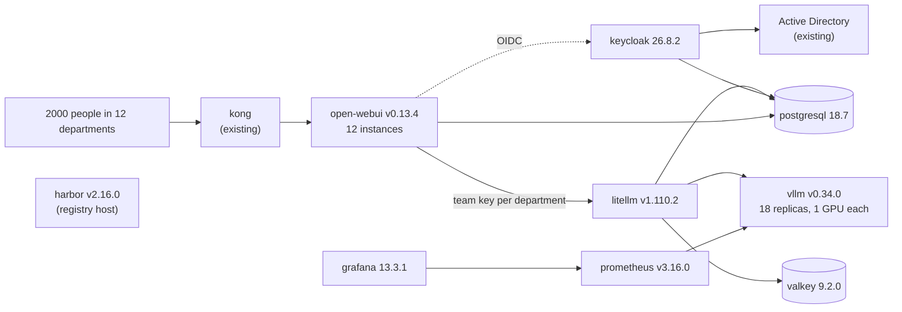

# Company chat platform: air-gapped blueprint

Status: draft, waiting for approval. Date: 2026-11-25. Language: en. Oldest catalog entry used: 2026-11-21 (`open-webui`, `keycloak`, `prometheus`, `valkey`).

This blueprint is a design aid built from public documentation and labelled estimates, not professional advice. Verify every number, choice and version, and run the benchmark in section 9, before buying hardware or deploying anything.

## 1. Context and answers

A company of 2,000 people in twelve departments gets a chat, coding-assistant and document-question platform on one 70-billion-parameter model (8-bit) on 24 GPUs in three servers, inside an air-gapped network. Departments must not see each other's data, every request must be attributable and retained, and the service may not go down. A platform team operates the system and already runs OpenShift. Kong is the existing API gateway and Active Directory the existing directory. Artifacts enter through a data diode about once a month. The user was not available for questions: everything the request did not state is `unknown` and takes the interview default.

| Question | Answer | From |
|---|---|---|
| `org.users_total` | 2000 | the user |
| `org.departments` | 12 | the user |
| `org.isolation` | `per_department` | the user ("departments must not see each other's data") |
| `org.audit_required` | `true` | the user ("every request must be attributable and retained") |
| `org.downtime_tolerance` | `none` | the user ("the service may not go down") |
| `org.ops_capacity` | `platform_team` | the user |
| `org.kubernetes_experience` | `true` | the user |
| `inside.operator` | `people_then_agent` | the user |
| `workload.usage` | chat 0.7, code assistant 0.2, rag 0.1 | the user |
| `workload.models` | one model: `role` `chat`, `params_b` 70, `precision` 8-bit (`fp8` or `int8`), `arch` 80 layers, 8 key-value heads, head dimension 128, 16-bit KV cache, `context_tokens` 8192, `name` `company-70b` (a label of this design) | the user |
| `hardware.gpus` | `[{model: "unnamed 141 GB GPU", count: 24, vram_gb: 141, tdp_w: 700, vendor: "nvidia"}]`, in three servers of eight | the user |
| `hardware.cpu_arch` | `amd64` | `unknown`, default |
| `existing.identity` | `ad_ldap` (Active Directory) | the user |
| `existing.api_gateway` | `kong` | the user |
| `existing.kubernetes` | `openshift` | the user |
| `existing.registry` | `none` | `unknown`, default |
| `transfer.channel` | `data_diode` | the user |
| `transfer.cadence` | `monthly` | the user |

Open questions (the design proceeds on the stated assumptions until they are answered):

1. **GPU model.** The user gave 141 GB, 700 W and the vendor (NVIDIA) but no model name.
2. **OpenShift details.** The version, whether the NVIDIA GPU stack for the nodes is installed, the namespace and the storage class for PostgreSQL, Valkey and the model files are not stated.
3. **Budget amounts and the internal price unit** per department (section 4, `llm-gateway`), and the audit retention period.
4. **Certificates and names**: the internal certificate authority, the route names and the LDAPS certificate for Active Directory.
5. **A host for Harbor** outside the cluster, with Docker Engine.
6. **High availability of PostgreSQL**: the catalog names no tooling for failure detection and promotion; the platform team's own practice decides.

## 2. Tier, floors and overrides

Base tier **T3**: 2,000 users is T3 (above 300), 12 departments is T3 (above 5).

| Layer | Floor | Raised by |
|---|---|---|
| `llm-serving` | T3 | none |
| `llm-gateway` | T3 | `org.audit_required` = true and `org.isolation` = `per_department` |
| `ui` | T3 | none |
| `identity` | T3 | `org.isolation` = `per_department` |
| `observability` | T3 | none |
| `orchestration` | T3 | none |
| `state` | T3 | none |
| `registry` | T3 | none |

Obligations:

- **A gateway is required.** Met: `litellm`, with the existing Kong in front of it.
- **At least two engine replicas** (`org.downtime_tolerance` = `none`); sizing gives 18.
- No "Isolation design" subsection: `org.isolation` is `per_department`.
- Kubernetes risk: the floor is T3 and the platform team runs OpenShift (`org.kubernetes_experience` = true), so the risk is accepted.

Overrides: none.

Custom parts (no catalog entry, each labelled `estimate`):

| Custom part | Decision | Why it is needed |
|---|---|---|
| Docker Engine and Docker Compose on the registry host | `registry` | Harbor's installer needs them; Compose is not in the catalog at the T3 floor. |

## 3. Architecture overview

The platform runs as workloads in the existing OpenShift cluster; the cluster itself is not installed by this design. People reach it through the existing Kong gateway, which forwards to twelve Open WebUI instances (one per department) authenticated by Keycloak federated to Active Directory. Each instance uses its department's team key on the LiteLLM gateway, which enforces budgets and writes the spend log to PostgreSQL, and spreads requests over 18 vLLM replicas of one GPU each, with prefix caching switched off. Harbor on its own host serves the images to the cluster.

Host: three GPU servers of eight GPUs (six replicas each) in the existing OpenShift cluster; Harbor on a separate host with Docker Engine.

## 4. Layer decisions

| Layer | Component | Version | Evidence |
|---|---|---|---|
| `llm-serving` | `vllm` | `v0.34.0` | estimate |
| `llm-gateway` | `litellm` | `v1.110.2` | estimate |
| `ui` | `open-webui` | `v0.13.4` | estimate |
| `identity` | `keycloak` | `26.8.2` | estimate |
| `observability` | `prometheus` | `v3.16.0` | estimate |
| `observability` | `grafana` | `13.3.1` | estimate |
| `state` | `postgresql` | `18.7` | estimate |
| `state` | `valkey` | `9.2.0` | estimate |
| `registry` | `harbor` | `v2.16.0` | estimate |

### `llm-serving`

- Components: `vllm` `v0.34.0`, 18 replicas of 1 GPU each (`replicas: 18`), requesting `nvidia.com/gpu: 1` each
- Existing: none
- Custom: none
- Benchmark only: none
- Rationale: GPUs are available and `concurrency.high` is 280; a platform team operates it. Prefix caching is switched off (`--no-enable-prefix-caching`) because twelve departments share the engines and vLLM's security page says requests from different callers share the caches. The engine listens only on the cluster network, reachable from the gateway, with an API key as a second layer. Model given as a local path with `HF_HUB_OFFLINE=1`; usage statistics off; `--enable-offline-docs`.
- Alternatives considered: `sglang` (no `field` evidence or user measurements), `ollama` (not a T3 engine).
- Evidence: `estimate`
- Override: none

### `llm-gateway`

- Components: `litellm` `v1.110.2` (Valkey configured from the start)
- Existing: Kong (`existing.api_gateway` = `kong`) stays the organization's entry point and forwards to LiteLLM
- Custom: none
- Benchmark only: none
- Rationale: audit and per-department isolation need per-team budgets, keys and per-request spend logs, which Kong's open-source edition does not document; LiteLLM provides them and Kong keeps its role in front. Each department is a LiteLLM team with `max_budget`, `budget_duration` and `tpm_limit`/`rpm_limit`. Budgets need an internal price per token in an internal copy of the cost map (`LITELLM_MODEL_COST_MAP_URL`). `LITELLM_MASTER_KEY` and `LITELLM_SALT_KEY` are required; the salt key cannot be rotated in place. Whether teams, keys and budgets run without a license is to be confirmed with the vendor (section 9).
- Alternatives considered: Kong alone (no documented budgets, SSO or audit logs).
- Evidence: `estimate`
- Override: none

### `ui`

- Components: `open-webui` `v0.13.4`, twelve single-replica instances, one per department, each with its own PostgreSQL database and role, `WEBUI_SECRET_KEY`, volume, OIDC client and LiteLLM team key
- Existing: none
- Custom: none (TLS terminates at the existing Kong and the OpenShift routes)
- Benchmark only: none
- Rationale: separate instances keep each department's chats, files and admin rights apart. `OFFLINE_MODE=true`; the standard image bakes in the default embedding model.
- Evidence: `estimate`
- Override: none

### `identity`

- Components: `keycloak` `26.8.2`, one realm federated to Active Directory over LDAPS, one OIDC client per department UI
- Existing: Active Directory (`existing.identity` = `ad_ldap`)
- Custom: none
- Benchmark only: none
- Rationale: every sign-in is tied to an AD account; each department's AD group decides who may sign in to its UI (department-scoped admission is checked in section 9). Production Keycloak needs PostgreSQL.
- Evidence: `estimate`
- Override: none

### `observability`

- Components: `prometheus` `v3.16.0`, `grafana` `13.3.1`
- Existing: none
- Custom: none
- Benchmark only: none
- Rationale: Prometheus scrapes vLLM's `/metrics`; Grafana shows queue and latency and alerts the platform team. `[plugins] preinstall_disabled = true` stops plugin downloads.
- Evidence: `estimate`
- Override: none

### `orchestration`

- Components: none
- Existing: the OpenShift cluster (`existing.kubernetes` = `openshift`)
- Custom: none
- Benchmark only: none
- Rationale: the platform team runs OpenShift today; the design is deployed into it. No cluster is installed or changed.
- Alternatives considered: `rke2` (a second cluster for no benefit).
- Evidence: `estimate`
- Override: none

### `state`

- Components: `postgresql` `18.7` (databases for `litellm`, `keycloak` and the twelve UIs, each with its own role), `valkey` `9.2.0` (separate database numbers per client)
- Existing: none
- Custom: none
- Benchmark only: none
- Rationale: `litellm` and `keycloak` require PostgreSQL; Valkey holds the gateway's counters and the UIs' session revocation. High availability beyond one primary is open question 6.
- Evidence: `estimate`
- Override: none

### `registry`

- Components: `harbor` `v2.16.0`, from the offline installer, on its own host, without `--with-trivy`
- Existing: none
- Custom: Docker Engine and Docker Compose on that host
- Benchmark only: none
- Rationale: images for the cluster come from Harbor; HTTPS is required and the administrator and database passwords are changed before first start.
- Alternatives considered: `distribution-registry` (T1 only).
- Evidence: `estimate`
- Override: none

## 5. Sizing

Inputs: 2,000 users; usage chat 0.7, code assistant 0.2, rag 0.1; context 8,192 tokens for every group; one model of 70B parameters at 8-bit, `arch` 80 layers, 8 KV heads, head dimension 128, fp16 KV cache; GPUs: 24 × unnamed 141 GB GPU at 700 W.

1. **Concurrency**: chat 2,000 × 0.7 × 0.20 × 0.25 = 70 to × 0.50 = 140; code 2,000 × 0.2 × 0.30 × 0.70 = 84 to × 1.00 = 120; rag 2,000 × 0.1 × 0.20 × 0.25 = 10 to 20. `concurrency` = **164 to 280**.
2. **Which GPU**: the only type, 141 GB and 700 W.
3. **Weights**: 70 × 1 = 70 GB. Required memory = 70 × 1.10 = **77.0 GB**.
4. **Smallest GPU group**: 1 GPU, usable 141 × 0.90 = 126.9 GB, enough.
5. **KV cache**: bytes per token = 2 × 80 × 8 × 128 × 2 = 327,680. Cached tokens = (126.9 − 77.0) × 10^9 ÷ 327,680 = 152,282. Tokens per request 8,192 + 1,024 = 9,216; 152,282 holds one.
6. **Replicas**: requests per replica = 152,282 ÷ 9,216 = 16 (rounded down). In flight 140 + 120 + 20 = 280. Replicas = 280 ÷ 16 = 17.5, rounded up to 18; the minimum is 2 (`org.downtime_tolerance` = `none`), so **18**. KV needed at peak = 280 × 9,216 × 327,680 ÷ 10^9 = 845.6 GB.
7. **A larger group per replica**: with 4-GPU replicas the memory model needs 8 GPUs instead of 18; tensor parallelism adds synchronization overhead, so benchmark throughput before choosing it. Not the design.
8. **Totals**: GPUs = 18 × 1 = **18**; servers = 18 ÷ 8 = 2.25, rounded up to **3**; power = 18 × 700 × 1.8 ÷ 1000 = 22.68, so **22.7 kW**.
9. **Fit**: 18 needed, 24 available: fits.

| Model | GPUs per replica | Replicas | GPUs | KV cache |
|---|---|---|---|---|
| `company-70b` | 1 | 18 | 18 | computed: 152,282 tokens per replica, 16 requests |

Assumptions: `hardware.cpu_arch` `amd64`, `existing.registry` `none` and the 1,024 output tokens are defaults (`estimate`); the constants of `references/sizing.md` are `estimate`.

## 6. Air-gap transfer

Files enter through a data diode about once a month (`transfer.channel` = `data_diode`, `transfer.cadence` = `monthly`). The checks are the manifest's. The list of everything to carry in is `docs/airgap/transfer-manifest.md`. Telemetry and egress settings to apply before first start are its section 4. Inside, people install first and an agent operates later (`inside.operator` = `people_then_agent`): they receive a runbook for people and rules for an agent. The next step after approval is `airgap-transfer`.

## 7. Data flow

1. A person opens their department's address; Kong forwards the request to that department's Open WebUI instance.
2. Open WebUI redirects to Keycloak (OIDC); Keycloak validates the password against Active Directory over LDAPS. Identity is checked here.
3. The person sends a message. Open WebUI stores it in the department's database and calls LiteLLM with the department's team key.
4. LiteLLM checks the key, the budget and the rate limits (counters in Valkey, spend in PostgreSQL) and forwards to one of the 18 vLLM replicas.
5. vLLM streams tokens back through LiteLLM to the browser; LiteLLM writes a spend-log row.

The department is tied by the team key held only by that department's UI; the person by the AD sign-in. The records are in PostgreSQL (spend log and chat history).

## 8. Failure modes and operations

| Failure | Effect | How it is noticed |
|---|---|---|
| One GPU or replica fails | The other replicas keep serving at reduced capacity | Grafana alert on missing engine metrics |
| One GPU server fails | Six replicas stop; twelve remain | Grafana alert |
| LiteLLM down | Chat stops | Open WebUI errors; Grafana alert |
| PostgreSQL down | Sign-in, the UIs and the gateway stop | Every service errors |
| Valkey restart | Sessions and counters reset; `fail_closed_budget_enforcement` is set | Container restart |
| Keycloak or Active Directory down | No new sign-ins | Sign-in errors |
| Harbor down | Running services continue; no new pulls | Pull failures at deploy time |

Backups: all PostgreSQL databases nightly to a target outside the cluster, with a tested restore; the Keycloak realm after every change; the keys and passwords in the platform team's secret store. Upgrades are a blueprint change made outside the network, a new manifest and bundle from `airgap-transfer`, carried through the diode and applied by the platform team one component at a time after a database backup, replica by replica for vLLM.

## 9. Verification plan

1. **Benchmark before production**, on the real servers with prefix caching off: tokens per second and time to first token at 164 and at 280 concurrent requests with 8,192-token prompts and 1,024-token answers; the KV-cache capacity per replica against the computed 16 requests; the throughput of one 4-GPU replica as an alternative.
2. Decisions with `estimate` evidence: `llm-serving` (offline first start, FlashInfer kernels), `llm-gateway` (which team and key features run without a license; spend above 0 with the internal price; the fields of a spend-log row), `ui` (department admission; `OFFLINE_MODE`), `identity` (AD federation over LDAPS; per-client admission by group), `observability` (Grafana offline), `state` (backup and restore drill), `registry` (installer, HTTPS, pushes and pulls).
3. Kubernetes risk: accepted, the platform team runs OpenShift.
4. Benchmarks a layer guide asked for: none.
5. Catalog entries last verified more than 180 days before 2026-11-25: none (oldest 2026-11-21).

## 10. Out of scope

This blueprint does not decide: deployment files (Kubernetes manifests, configuration); the choice of the model itself and its exact repository and revision; the budget amounts, internal price unit and audit retention period; the operating system, host hardening and network firewall rules; the certificate authority; CI/CD; data classification and compliance mapping; the OpenShift cluster itself.
