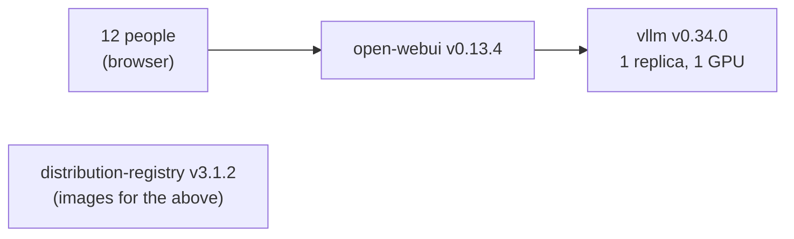

# Research lab chat assistant: air-gapped blueprint

Status: draft, waiting for approval. Date: 2026-11-25. Language: en. Oldest catalog entry used: 2026-11-21 (`open-webui`).

This blueprint is a design aid built from public documentation and labelled estimates, not professional advice. Verify every number, choice and version, and run the benchmark in section 9, before buying hardware or deploying anything.

## 1. Context and answers

A research lab of 12 people in one team gets a private chat assistant on one workstation with one 24 GB GPU, inside a network with no internet connection. Nobody else shares the system, there are no audit or compliance rules, and people may see each other's conversations. One person looks after the machine part-time and the lab does not run Kubernetes. Files enter on removable media. The user was not available for questions: everything the request did not state is `unknown` and takes the interview default.

| Question | Answer | From |
|---|---|---|
| `org.users_total` | 12 | the user |
| `org.departments` | 1 | the user |
| `org.isolation` | `none` | the user ("people may see each other's conversations") |
| `org.audit_required` | `false` | the user ("no audit or compliance rules") |
| `org.downtime_tolerance` | `accepted` | the user ("if it is down for a day, nobody is hurt") |
| `org.ops_capacity` | `part_time_one` | the user |
| `org.kubernetes_experience` | `false` | the user |
| `inside.operator` | `people` | the user |
| `workload.usage` | chat 1.0 | the user |
| `workload.models` | one model: `role` `chat`, `params_b` 8, `precision` 8-bit (`fp8` or `int8`, not stated which), `arch` unknown, `name` `lab-8b` (a label of this design, not the model's name) | the user |
| `hardware.gpus` | `[{model: "unnamed 24 GB GPU", count: 1, vram_gb: 24, vendor: "nvidia"}]` | the user |
| `hardware.cpu_arch` | `amd64` | `unknown`, default |
| `existing.identity` | `none` | the user |
| `existing.api_gateway` | `none` | the user |
| `existing.kubernetes` | `none` | the user |
| `existing.registry` | `none` | the user |
| `transfer.channel` | `removable_media` | the user |

Open questions (the design proceeds on the stated assumptions until they are answered):

1. **The model's name, its 8-bit format and its architecture numbers.** Without `config.json` numbers the KV-cache capacity cannot be computed, only measured.
2. **Disk space** on the workstation: at least the weight files (about 8 GB by arithmetic), the images and the chat database.
3. **Docker Engine and the operating system** on the workstation: already installed or carried in.

## 2. Tier, floors and overrides

Base tier **T1**: 12 users is T1 (up to 50), 1 department is T1; the higher of the two is T1.

| Layer | Floor | Raised by |
|---|---|---|
| `llm-serving` | T1 | none |
| `llm-gateway` | T1 | none |
| `ui` | T1 | none |
| `identity` | T1 | none |
| `observability` | T1 | none |
| `orchestration` | T1 | none |
| `state` | T1 | none |
| `registry` | T1 | none |

Obligations: none. No gateway is required (`org.audit_required` is `false`, `org.isolation` is `none`); no replica obligation (`org.downtime_tolerance` is `accepted`); no Kubernetes risk (the `orchestration` floor is T1).

Overrides: none.

Custom parts (no catalog entry, each labelled `estimate`):

| Custom part | Decision | Why it is needed |
|---|---|---|
| Docker Engine | `orchestration` | Compose does not start containers itself; it talks to the engine. |
| Host GPU stack (for NVIDIA the driver and the NVIDIA Container Toolkit) | `orchestration` | The engine container needs the GPU. |

## 3. Architecture overview

Everything runs on the one workstation as containers under Docker Compose. People open Open WebUI in a browser; Open WebUI calls the vLLM engine directly, because no gateway is needed. The images are served from a plain registry on the same host.

Host: one workstation with 1 GPU, Docker Engine and the host GPU stack (custom), `docker-compose` v5.8.0.

## 4. Layer decisions

| Layer | Component | Version | Evidence |
|---|---|---|---|
| `llm-serving` | `vllm` | `v0.34.0` | estimate |
| `ui` | `open-webui` | `v0.13.4` | estimate |
| `orchestration` | `docker-compose` | `v5.8.0` | estimate |
| `registry` | `distribution-registry` | `v3.1.2` | estimate |

### `llm-serving`

- Components: `vllm` `v0.34.0`, one replica on the one GPU
- Existing: none
- Custom: none
- Benchmark only: none
- Rationale: there is a GPU and the operator is one part-time person; `concurrency.high` is 2. vLLM serves an OpenAI-compatible endpoint on port 8000 in the documentation examples.
- Alternatives considered: `ollama` (simpler, T1 and T2); not chosen because the user named vLLM as the engine of the design.
- Evidence: `estimate`
- Override: none

### `llm-gateway`

- Components: none
- Existing: none
- Custom: none
- Benchmark only: none
- Rationale: no audit, no isolation, no budgets; Open WebUI talks to the engine directly.
- Evidence: `estimate`
- Override: none

### `ui`

- Components: `open-webui` `v0.13.4`
- Existing: none
- Custom: none
- Benchmark only: none
- Rationale: the chat interface for 12 people with local accounts; people may see each other's conversations.
- Evidence: `estimate`
- Override: none

### `identity`

- Components: none
- Existing: none (`existing.identity` is `none`)
- Custom: none
- Benchmark only: none
- Rationale: Open WebUI's own accounts are enough for one team.
- Evidence: `estimate`
- Override: none

### `observability`

- Components: none
- Existing: none
- Custom: none
- Benchmark only: none
- Rationale: nobody is hurt by a day of downtime; the operator reads the container logs.
- Evidence: `estimate`
- Override: none

### `orchestration`

- Components: `docker-compose` `v5.8.0`
- Existing: none
- Custom: Docker Engine, host GPU stack
- Benchmark only: none
- Rationale: one host, one YAML file, no Kubernetes experience.
- Alternatives considered: `k3s`; not chosen because nobody runs Kubernetes.
- Evidence: `estimate`
- Override: none

### `state`

- Components: none
- Existing: none
- Custom: none
- Benchmark only: none
- Rationale: Open WebUI keeps its data in its own volume.
- Evidence: `estimate`
- Override: none

### `registry`

- Components: `distribution-registry` `v3.1.2`
- Existing: none
- Custom: none
- Benchmark only: none
- Rationale: a plain image store is enough for one host and one operator; the registry must be protected by TLS and access control before anyone else on the network can reach it.
- Alternatives considered: `harbor`; not chosen because it is heavier than one workstation needs.
- Evidence: `estimate`
- Override: none

## 5. Sizing

Inputs: 12 users; usage chat 1.0; context per request 8,192 tokens (the default); one model, role `chat`, 8B parameters at 8-bit (1 byte per parameter), no `arch`; GPUs: 1 × unnamed 24 GB GPU.

1. **Concurrency**: low = 12 × 1.0 × 0.20 × 0.25 = 0.6, rounded up to 1; high = 12 × 1.0 × 0.20 × 0.50 = 1.2, rounded up to 2. `concurrency` = **1 to 2**.
2. **Which GPU**: the only type, 24 GB from the user's answer.
3. **Weights**: 8 × 1 = 8 GB. Required memory = 8 × 1.10 = **8.8 GB**.
4. **Smallest GPU group**: 1 GPU, usable 24 × 0.90 = 21.6 GB, enough.
5. **KV cache**: no `arch`, so KV capacity is **unknown**; 21.6 − 8.8 = 12.8 GB remain, which cannot be turned into a number of requests.
6. **Replicas**: minimum 1. **Replicas = 1**.
7. **A larger group per replica**: not applicable; one GPU is the whole hardware.
8. **Totals**: GPUs = 1 × 1 = **1**; servers = 1. Power: not computed (the GPU's power was not given).
9. **Fit**: 1 needed, 1 available: fits.

| Model | GPUs per replica | Replicas | GPUs | KV cache |
|---|---|---|---|---|
| `lab-8b` | 1 | 1 | 1 | unknown |

Assumptions: `hardware.cpu_arch` `amd64` (default); the context of 8,192 tokens and the 1,024 output tokens are defaults of the design (`estimate`).

## 6. Air-gap transfer

Files enter on removable media (`transfer.channel` = `removable_media`). The checks are the manifest's. The list of everything to carry in is `docs/airgap/transfer-manifest.md`. Telemetry and egress settings to apply before first start are its section 4. Inside, people install and operate (`inside.operator` = `people`); the next step after approval is `airgap-transfer`.

## 7. Data flow

1. A person opens Open WebUI in a browser and signs in with a local account.
2. Open WebUI sends the chat request to vLLM on the internal network.
3. vLLM batches the request and streams tokens back to Open WebUI and the browser.
4. Open WebUI stores the chat in its own volume.

Nothing is tied to a department; there is one team and no audit requirement.

## 8. Failure modes and operations

| Failure | Effect | How it is noticed |
|---|---|---|
| Workstation down | Everything stops | People |
| vLLM crashes | Chat stops until the container restarts and reloads the weights | Open WebUI errors |
| Open WebUI down | No chat; the engine keeps running | People |
| Registry down | Running services continue; no re-deploy | Pull failures at deploy time |
| Disk full | Writes fail | The operator's routine check |

Backups: the Open WebUI data volume weekly to a target off the workstation; the model files and images are in the checked transfer bundle. Upgrades are a blueprint change made outside the network, with a new manifest and bundle from `airgap-transfer`, applied by the operator one component at a time.

## 9. Verification plan

1. **Benchmark before production**, on the real workstation: tokens per second and time to first token at 1 and at 2 concurrent requests with 8,192-token prompts and 1,024-token answers; also the KV-cache capacity that sizing could not compute.
2. Decisions with `estimate` evidence: `llm-serving` (vLLM v0.34.0 runs the named model in its 8-bit format on this GPU; offline first start with `HF_HUB_OFFLINE=1`), `ui` (`OFFLINE_MODE` starts cleanly), `orchestration` (Docker Engine and the host GPU stack install from carried files only; `pull_policy: never` makes a missing image fail), `registry` (every image can be pushed and pulled).
3. Kubernetes risk: not applicable (`orchestration` floor T1).
4. Benchmarks a layer guide asked for: none.
5. Catalog entries last verified more than 180 days before 2026-11-25: none (oldest 2026-11-21).

## 10. Out of scope

This blueprint does not decide: deployment files (Compose file, `.env`, configuration); the choice of the model itself and its exact repository and revision; the operating system, host hardening and network firewall rules; the certificate authority; CI/CD; data classification and compliance mapping.
